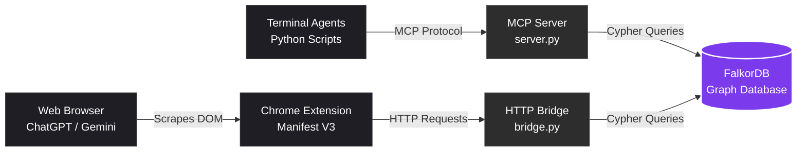

<div align="center">
<br>

# Mnemo
**Universal, Graph-Backed Memory Layer for AI Agents**
<br>

Mnemo is a persistent memory infrastructure that allows distinct AI agents to share context, recall facts autonomously, and maintain provenance across different platforms.
<br>

[Architecture](#architecture) • [Features](#features) • [Data Model](#data-model) • [Getting Started](#getting-started)

<br>

</div>

---

# Overview

## The Problem

Modern AI applications suffer from a fundamental flaw: session amnesia.
- **Session Isolation:** Terminal agents (like Cursor or custom Python scripts) lose all context the moment their process terminates.
- **Walled Gardens:** Web-based interfaces (ChatGPT, Claude, Gemini) operate in closed ecosystems. A context established in one model cannot be accessed by another.
- **The Vector Database Trap:** Most memory solutions rely on flat vector search. This lacks provenance (knowing *why* a fact is known) and fails to capture the relational structure between entities (e.g., how Alice connects to Project X and FalkorDB).

## The Solution

**Mnemo** acts as a universal memory router that decouples AI memory from the AI model itself. 

Instead of relying on the model's internal context window, Mnemo provides an external memory layer. By combining the **Model Context Protocol (MCP)** with a **FalkorDB property graph**, Mnemo enables any compatible AI to:
1. **Save** facts and session data to a localized graph database.
2. **Recall** context autonomously across completely different platforms.
3. **Trace** provenance, permanently linking every memory to the specific agent that wrote it.

Because the entire stack (database, LLM extraction, and memory routing) runs locally, sensitive context never leaves your machine.

---

## 🏗️ Architecture Overview




### Component Breakdown

- **Terminal Agents (`agent_a.py`, `agent_b.py`)**
  Python scripts that use local LLMs to extract facts and talk to the database via MCP.

- **MCP Server (`server.py`)**
  Exposes `remember` and `recall` tools to any MCP-compatible AI client.

- **HTTP Bridge (`bridge.py`)**
  A FastAPI server that allows the browser extension to talk to the local database.

- **Chrome Extension (`extension/`)**
  Scrapes web AI chats (ChatGPT/Gemini) and injects saved context into the prompt box.

- **FalkorDB**
  The graph database that stores the connections between agents, memories, and entities.

---

## Core Features

- **MCP Native Integration:** Built directly on the Model Context Protocol. Any compatible client (Claude Desktop, Cursor, custom scripts) can instantly plug in and use the memory tools.
- **Cross-Platform Memory Bridge:** A custom FastAPI bridge and Chrome extension connect web-based AIs (ChatGPT, Gemini) to the exact same memory graph used by local terminal agents.
- **Graph-Based Provenance:** Unlike vector databases, Mnemo never loses context. Every memory is stored as a node permanently linked to the specific Agent that created it.
- **Relational Multi-Hop Reasoning:** Retrieval works by traversing actual entity relationships. The system knows *how* an entity is connected to a memory, not just that it is semantically similar.
- **100% Local & Private:** No OpenAI API keys or cloud subscriptions required. Entity extraction and answering are handled by local Ollama models, and data is stored locally in Dockerized FalkorDB.

---

## Tech Stack

| Layer | Technology | Purpose |
| :--- | :--- | :--- |
| **Database** | [FalkorDB](https://www.falkordb.com/) | High-performance graph database used to store memories and relationships via Cypher queries. |
| **Protocol** | [Model Context Protocol (MCP)](https://modelcontextprotocol.io/) | Standardized interface allowing AI agents to call memory tools natively. |
| **Backend Bridge** | [FastAPI](https://fastapi.tiangolo.com/) & [Uvicorn](https://www.uvicorn.org/) | Translates HTTP requests from the browser extension into graph database operations. |
| **AI Engine** | [Ollama](https://ollama.com/) (`gemma4:e2b`) | Fully local LLM used for entity extraction and answer generation. |
| **Extension** | Chrome Manifest V3 | Injects memory tools into web-based AI interfaces (ChatGPT, Gemini). |
| **Languages** | Python 3.10+ & Vanilla JS | Backend logic and browser extension scripts. |

---

## Data Model

Mnemo uses a property graph to represent memories and their relationships. Rather than storing isolated text blocks, it builds a connected network of Agents, Memories, and Entities.

### Graph Schema

```cypher
(:Agent {id})
   │
   └─[:WROTE]─► (:Memory {id, text, kind, created_at})
                   │
                   └─[:MENTIONS]─► (:Entity {name})
```

### Core Cypher Queries

The following queries illustrate the graph operations used by the memory layer. Adapt them to your actual database schema and application code as needed.

#### 1. Storing a Memory and Extracting Entities

Create a memory, associate it with the authoring agent, and link the memory to extracted entities.

```cypher
MERGE (a:Agent {id: $agent})
CREATE (m:Memory {
    id: $mid,
    text: $text,
    kind: $kind,
    agent: $agent,
    created_at: $ts
})
MERGE (a)-[:WROTE]->(m)
WITH m
UNWIND $ents AS e
MERGE (en:Entity {name: e})
MERGE (m)-[:MENTIONS]->(en)
```

#### 2. Recalling Memories Through Graph Traversal

Find memories connected to entities mentioned in a query.

```cypher
MATCH (m:Memory)-[:MENTIONS]->(e:Entity)
WHERE e.name IN $names
RETURN DISTINCT
    m.id,
    m.text,
    m.agent,
    m.kind,
    m.created_at
ORDER BY m.created_at DESC
LIMIT $limit
```

**Note:** These examples assume that the relevant parameters are supplied by the application. Verify compatibility with your FalkorDB client and Cypher implementation before using them.

---

## 📸 Screenshots

### 1. Terminal Agents Sharing Memory Through MCP


### 2. FalkorDB Graph Visualization


### 3. Browser Extension Integration


---

## 🚀 Setup & Installation

Follow these steps to run Mnemo locally.

### Prerequisites

Make sure you have the following installed:

- [Docker Desktop](https://www.docker.com/products/docker-desktop/)
- [Python 3.10 or later](https://www.python.org/downloads/)
- [Ollama](https://ollama.com/)
- Git, if you are cloning the repository

### 1. Start FalkorDB

Start the graph database using Docker.

**Windows:**

```powershell
docker.exe run -d --name mnemo-falkordb -p 6379:6379 -p 3000:3000 falkordb/falkordb:latest
```

**macOS/Linux:**

```bash
docker run -d --name mnemo-falkordb -p 6379:6379 -p 3000:3000 falkordb/falkordb:latest
```

The database is exposed on port `6379`, and the web interface is exposed on port `3000`, according to the configuration above.

Open the dashboard at:

**http://localhost:3000**

If you already have a container named `mnemo-falkordb`, reuse it or remove it before creating another container with the same name.

### 2. Install Python Dependencies

Optionally, create and activate a virtual environment.

**Windows PowerShell:**

```powershell
python -m venv .venv
.venv\Scripts\Activate.ps1
```

**macOS/Linux:**

```bash
python3 -m venv .venv
source .venv/bin/activate
```

Install the required packages:

```bash
pip install fastmcp==3.4.9 falkordb ollama fastapi uvicorn
```

### 3. Configure Ollama

Ensure Ollama is installed and running. Pull the model used by this project:

```bash
ollama pull gemma4:e2b
```

Confirm that the model is available:

```bash
ollama list
```

### 4. Run the Terminal Agents

Use two separate terminal processes to test memory sharing through MCP.

**Terminal 1 — Store a memory:**

```bash
python agent_a.py "Alice is building the FalkorDB hackathon project. Deadline is Oct 18."
```

**Terminal 2 — Recall the memory:**

```bash
python agent_b.py "What do you know about Alice and the deadline?"
```

The second agent should retrieve relevant information saved by the first agent, provided both scripts are configured to use the same Mnemo server and graph database.

### 5. Start the HTTP Bridge

Start the FastAPI bridge so the browser extension can communicate with Mnemo.

```bash
python bridge.py
```

Keep the terminal running. The bridge is expected to listen at:

**http://127.0.0.1:8000**

If your application uses a different host or port, update the extension configuration accordingly.

### 6. Load the Chrome Extension

1. Open Google Chrome.
2. Navigate to `chrome://extensions/`.
3. Enable **Developer mode**.
4. Click **Load unpacked**.
5. Select the `extension/` directory in the Mnemo repository.
6. Open a supported AI interface, such as ChatGPT, Claude, or Gemini.
7. Use the extension's memory controls, if implemented, to save a session or inject recalled memories.

The extension should be configured to communicate with the local bridge at `http://127.0.0.1:8000`.

---

## 📄 License

Add your chosen license here, along with a link to the repository's `LICENSE` file if one exists.